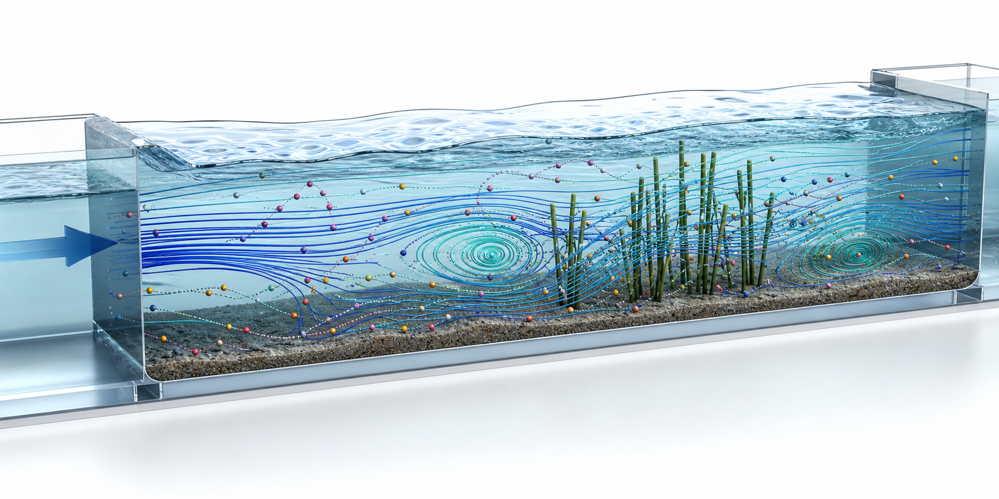

# Microplastic Modeling in Water Systems



This repository accompanies the paper **A GPU Accelerated Eulerian-Lagrangian Model for Microplastics Transport in Water Systems** by Danial Goodarzi, Abdolmajid Mohammadian, Abolghasem Pilechi and Soroush Abolfathi (manuscript in preparation).

**Project page:** <https://hydrocfd.github.io/vegetated-channel-microplastics/>

> **Note:** The source code of the model will be uploaded to this repository after the paper is published.

## What the model does

Aquatic vegetation modifies the velocity distribution in open channels and affects the longitudinal dispersion and the fate of microplastics, whose transport also depends on their size, density and shape. Existing models either treat microplastics as dissolved tracers with a prescribed settling velocity, or resolve the forces on individual particles at a computational cost that restricts them to small domains and short durations.

The model in this repository occupies the middle ground. The flow in vegetated and non-vegetated channels is computed once in OpenFOAM, and every microplastic is then tracked on a graphics processing unit with its own force balance.

## Workflow

1. **Flow in OpenFOAM.** Reynolds-averaged Navier-Stokes equations with the RNG k-ε turbulence model. The vegetation enters as a distributed drag force, proportional to the stem drag coefficient and the frontal area of the stems per unit volume, and as an additional dissipation of turbulence generated by the stem wakes.
2. **Lookup grid on the GPU.** The velocity, eddy viscosity, vorticity and the gradient of the eddy diffusivity are mapped once onto a structured grid stretched toward the bed and the side walls, so the hosting cell of a particle is found from a closed-form index.
3. **Particles on the GPU (Python and CuPy).** One GPU thread per particle calculates the force balance, the velocity update, the random walk and the boundary rules.
4. **Virtual stations.** Crossings at the locations of the laboratory instruments give the response curves, and the longitudinal dispersion coefficients are calculated with the method of moments.

## Particle model

- Drag: Schiller-Naumann law for spheres and a shape-dependent drag for cylinders, fibres, disks, plates, cubes, prisms, tetrahedra and irregular particles.
- A drag coefficient that depends on the turbulence for particles of millimetre size.
- Body force of gravity and buoyancy, added mass of the surrounding water, and Saffman lift in sheared flow.
- Turbulent dispersion as a random displacement scaled by the eddy diffusivity, with a drift correction.
- An exponential drag integrator that is exact for the linearized drag and stable for time steps larger than the particle relaxation time.
- Boundary rules: deposition and re-entrainment at the bed with the Shields criterion, rebound at the walls with normal and tangential restitution coefficients, and trapping of microplastics lighter than the water at the free surface.

## Laboratory datasets used for testing

| Dataset | Reference |
|---|---|
| Longitudinal dispersion of neutrally buoyant microplastics in non-vegetated channels and in channels with low and high submerged vegetation, measured at the University of Warwick | Stride, B., Abolfathi, S., Odara, M. G. N., Bending, G. D., & Pearson, J. (2023). Modeling microplastic and solute transport in vegetated flows. *Water Resources Research*, 59, e2023WR034653. <https://doi.org/10.1029/2023WR034653> |
| Longitudinal dispersion of microplastics lighter and denser than the water in a non-vegetated flume, measured at the University of Warwick | Stride, B., Abolfathi, S., Bending, G. D., & Pearson, J. (2024). Quantifying microplastic dispersion due to density effects. *Journal of Hazardous Materials*, 466, 133440. <https://doi.org/10.1016/j.jhazmat.2024.133440> |
| Settling velocities of particles of regular and irregular shapes in still water | Goral, K. D., Guler, H. G., Larsen, B. E., Carstensen, S., Christensen, E. D., Kerpen, N. B., Schlurmann, T., & Fuhrman, D. R. (2023). Settling velocity of microplastic particles having regular and irregular shapes. *Environmental Research*, 228, 115783. <https://doi.org/10.1016/j.envres.2023.115783> |
| Settling of millimetre spheres in turbulent open-channel flow | Ijaz, U., Baki, A. B. M., Wu, W., & Zhang, W. (2024). Settling velocity of microplastics in turbulent open-channel flow. *Science of the Total Environment*, 946, 174179. <https://doi.org/10.1016/j.scitotenv.2024.174179> |

## Repository layout

```text
microplastic_modeling/
  README.md
  CITATION.cff
  index.html            redirects to the project page
  assets/               images used by this README
  docs/
    project_overview.md
    github_setup.md
  scripts/
    generate_visuals.py
  data/
    README.md
  figures/
  animations/
  requirements.txt
```

## Quick start

Install the plotting dependencies:

```powershell
python -m pip install -r requirements.txt
```

Generate example graphs and an animation from local project data:

```powershell
python scripts/generate_visuals.py --source-root ".."
```

Outputs are written to `figures/` and `animations/`.

## Authors

- **Danial Goodarzi**, Department of Civil Engineering, University of Ottawa. Lead developer.
- **Abdolmajid Mohammadian**, Department of Civil Engineering, University of Ottawa.
- **Abolghasem Pilechi**, University of Ottawa, and Ocean, Coastal & River Engineering Research Centre, National Research Council Canada.
- **Soroush Abolfathi**, School of Engineering, University of Warwick, United Kingdom.

## Cite our work

If you use this repository, please cite the related paper once the final bibliographic information is available:

Goodarzi, D., Mohammadian, A., Pilechi, A., & Abolfathi, S. (in preparation). *A GPU Accelerated Eulerian-Lagrangian Model for Microplastics Transport in Water Systems*.

You can also cite the repository directly (see `CITATION.cff`):

```bibtex
@misc{microplastic_modeling,
  author       = {Goodarzi, Danial and Mohammadian, Abdolmajid and Pilechi, Abolghasem and Abolfathi, Soroush},
  title        = {Microplastic Modeling in Water Systems: a GPU accelerated Eulerian-Lagrangian model for microplastics transport},
  year         = {2026},
  url          = {https://github.com/HydroCFD/microplastic_modeling},
  note         = {GitHub repository}
}
```

## Data policy

Large OpenFOAM, VTK, Excel, PDF and result folders are excluded by `.gitignore`. This repository keeps source code, documentation, small processed examples, figures and animations. Large datasets should be archived through Zenodo, OSF, institutional storage, Git LFS or a separate data release.
